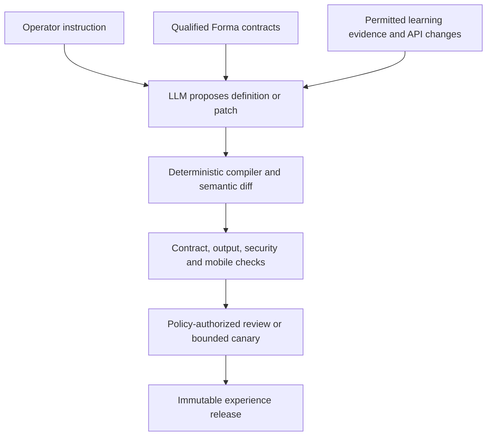
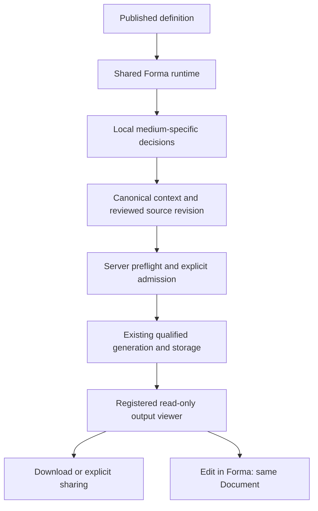

# Forma mini-apps: one configurable experience runtime

Architecture revision · September 2, 2026

**Implementation status · September 6, 2026:** Work is active, incomplete and not deployment-ready. The corrected detached candidate passed all 498 tests across 35 whole files and all 11 static/build/test stages; the deployment owner accepted that independently reviewed local scope. This does not qualify browser behavior or canonical integration. Governance’s original 24-case browser run remains failed and preserved. The corrected shared-bundle preparation and concrete Governance runner source are implemented and owner-accepted. The user approved the one reviewed shared-material compile. Its original run completed successfully and the saved result audit is independently reviewed and owner-accepted for preparation scope. Both fifteen-role evidence-binding overlays are source-reviewed and owner-accepted. Coherent Governance/Maintenance caller and fixture source is now owner-accepted. The six-subject syntax capture source is independently/root reviewed and delivered; syntax and browser/backend execution remain separate. Maintenance’s distinct 12-case semantic verifier and corrected bindings are sealed and independently/root reviewed; its concrete runner and fixture are implemented, sealed and owner source-accepted. Ten syntax checks passed in one separately authorized run; independent/root evidence review and deployment-owner saved-syntax acceptance are complete. Header’s coherent C44/D6 source rebind is accepted; all nine syntax checks passed in one authorized run, with independent evidence review and owner acceptance complete. The final Header C45/D7 browser packet is owner source-accepted; its complete checker/issuer/binding successor is sealed and independently/root reviewed. The separate two-file syntax capture was owner-accepted and run once; both checks passed and independent/root saved-evidence reviews are clear. The deployment owner accepted final checker source and the syntax-only actual. A narrow schema-v2 proposal now separates current two-file syntax evidence from the retained nine-file predecessor evidence, replacing a stale global status flag; the owner accepted the reviewed source correction and issued its genuine v2 source-only acceptance. The one-line acceptance binding is complete, and the owner subsequently ran the sole preflight successfully. A detached two-slot issuer source now binds that exact receipt and complete original tool results; it is independently reviewed, sealed and owner-accepted, together with the preflight evidence. The owner completed and accepted the sole issuance/readback, then ran the native caller once; it failed before browser-child launch, leaving all eight cases unrun. The failed directory group conflicts with the source-required group; this is the likely setup cause, although the first exception is truncated. The owner accepted the implemented, independently reviewed descriptor-only custody correction. The separately implemented 35-byte first-failure diagnostic is also owner source-accepted; both corrections preserve existing guards and limits. A narrow C46/D8 source plan is complete and independently reviewed. The owner reports independently accepted C46 quality: 382 successful executions, types, lint and normal build, with the earlier environment failure preserved. Final C47/D8 data and its shared handoff are now accepted; the saved five-module/seven-server graph is unchanged. The owner corrected the private allocation and Python issuer literals. The C47/D8 browser packet, unbound issuer, corrected checker, retained two-subject capture source and final command proposal are implemented and independently source-reviewed. The checker now binds the exact capture command/cwd and accepts genuine immediate or finite-wait tool completion while preserving original transport metadata. ROOT reconstructed all six complete checker diffs. The consolidated source manifest and its 37 declared payloads passed independent final review and were delivered to the deployment owner. The deployment owner then ran the current two-subject syntax capture once; both checks passed, and the genuine saved Actual review is accepted. The checker now consumes the real plain-mkdir setup and invocation result envelope, binds the exact performed review checks, and uses an owner-accepted permissions distinction only for the documentary transport record. No initial setup identity or continuity is invented. ROOT created the explicitly delegated three-group source acceptance and implemented the exact actual-binding successor; independent source review is clear. The owner’s sole subsequent preflight closed successfully, but independent review rejected its receipt because a reused syntax-loop variable overwrote the Header expectation anchor. Issuer binding stopped before any successor was written. The narrow R5 correction is implemented and independently source-reviewed: a distinct loop variable preserves the Header anchor, a serialized-anchor guard runs before output creation, and the source names the owner-allocated inert output path. The final source handoff is delivered. The deployment owner holds current-build preflight and native execution until the next combined P6/Canvas/Comparison checkpoint and build/linkage cycle. The rejected receipt and original sources remain preserved; no R5 execution or issuer binding occurred. C48 integration quality is now owner-accepted, and the exact D9 saved source/build ACTUAL_ACCEPT is bound into a minimal retained Header source proposal. That proposal passed independent review and was handed off. The final D9 shared handoff and corrected private allocation literals are received, and the owner approved the explicit v4 historical/current syntax separation. The retained C48/D9 browser/binding, unbound issuer, capture source, checker and command proposal are implemented. Independent source review found a current-only setup-command spelling mismatch; it is corrected without changing historical evidence, and the command now pins that exact checker. Final retained-source and 27-payload manifest review are complete, and the consolidated handoff is delivered. The deployment owner completed the current two-subject syntax capture once; both checks passed. The independent and ROOT saved-evidence reviews are clear, and the exact review receipt is delivered. The genuine owner v4 source acceptance is received and verified. The minimal actual-bound checker, command proposal, complete reversible diffs and single six-payload proof are implemented, independently/root source-reviewed clear, and handed off to the deployment owner for the preflight stage. All six current checker evidence/acceptance slots are bound to genuine records. The owner accepted and ran the sole preflight successfully; independent and ROOT saved-evidence reviews are clear, including the corrected Header expectation anchor. The minimal two-slot issuer successor now binds that receipt and both complete original tool-result objects, with all other issuer bytes unchanged. Its command proposal, full reversible diffs and single six-payload proof are implemented and independently/ROOT source-reviewed clear. The owner accepted the exact seven-file source handoff and completed the sole issuance successfully. Genuine Gate, Approval, readback and original transport passed independent and ROOT saved-evidence review with no findings. The owner accepted the readback and ran the sole current native test: all eight profiles failed at backward focus onto the active workspace link, whose outward focus ring is clipped by its scroll container. Initial language-select focus passed. No profile is qualified; later selection/restoration/settings journeys remain unmet. Saved cleanup records show no kill was sent. The owner-authorized minimal isolated shared-switcher correction is implemented: a full-token-width inset ring, small container padding, and one existing-suite regression. Independent and ROOT source review are clear. The owner accepted the focused patch and authorized one isolated responsive-layout suite run: all 15 tests passed, with both source hashes and identities unchanged. The complete saved result passed ROOT and independent review and is now accepted by the deployment owner; this qualifies source contracts only. The owner reports the focused patch integrated in C49 with the combined UI repairs; the canonical suite retains all 15 cases plus an existing prompt-fan case. The saved combined receipt records 408 passing tests and successful types, scoped lint and normal build, now accepted by the deployment owner after independent review. A minimal C49/D10 successor plan reusing the accepted Header journey and safeguards is complete, independently/ROOT reviewed clear and owner source-plan accepted. D10, its final shared handoff and the exact owner source allocation are accepted. The C49/D10 browser, issuer, syntax-capture source, corrected checker, command proposals and consolidated manifest are implemented, independently reviewed and delivered to the deployment owner. The owner accepted the current source and both narrow syntax checks passed once. Genuine saved review and v5 acceptance are complete. The minimal actual-bound checker, command and issuer successors are independently/ROOT source-reviewed and delivered. The owner completed preflight and issuance, then ran native qualification once: one profile passed and seven failed. Saved evidence points to transient picker-icon rotation affecting selector-width measurements; source and screenshot diagnosis continues. No browser oracle was weakened, no native retry occurred, and passing source checks do not qualify this failed native run. Prior versions and actual evidence remain preserved; no browser behavior is newly qualified. Unknown outputs remain qualification-required, never automatically enabled. Maximum-length media layout, public generation, canonical custody and same-Document continuation across all eight outputs, full adaptive maintenance, integration and physical-device qualification remain unfinished. The deployment owner controls integration and publishing; no Outputs release is deployed. The [current progress checkpoint](/Users/westbrook/.codex/visualizations/2026/09/02/01a06268-c0b2-7c43-b315-32320ab45634/mini-app-progress.json) and [evidence ledger](/Users/westbrook/.codex/visualizations/2026/09/02/01a06268-c0b2-7c43-b315-32320ab45634/mini-app-deployment-readiness.md) distinguish source review, local checks, integration and deployment. The [initial Stage 1A checkpoint](/Users/westbrook/.codex/visualizations/2026/09/02/01a06268-c0b2-7c43-b315-32320ab45634/forma-experience-runtime/docs/forma-experience-runtime-implementation-2026-09-02.md) is historical; accompanying wireframes remain illustrative.

**Current checkpoint:** All seven report decisions are resolved with their original answers retained. Server-supported recovery is required; client-only recovery is not release-complete. The bounded recovery source, corrected SQL/CAS tests, ten behavioral tests and a three-file settlement/publication guard correction are source-reviewed and delivered. No recovery tests or compiler checks have run; isolated qualification is pending with the deployment owner. Browser-closed wakeup and committing/terminal publication remain required follow-ons. It must preserve the original job, authority, input, receipt and budget without automatic duplicate purchases. Terminal grants are not silently reopened. The Document-receipt delta requires the existing Host/intake base; catalog integration requires the original 96-label prerequisite plus four CEM labels per locale. These dependencies remain for a later coherent owner integration checkpoint. No canonical C49 changes or release follow from this report update.

**Relationship to the earlier plan:** This replaces the separate mini-app implementation strategy in the [eight-output proposal](/Users/westbrook/Documents/repos/codex/docs/forma-mini-app-proposal-2026-09-02.md). Its output promises, medium-specific interactions, functional microcopy, mobile/touch contracts, privacy, sponsored admission, and same-Document handoff remain requirements. Eight experiences become eight initial configurations of one system.

**Prerequisite update:** The accepted 3D source/schema integration is included in verified production 179 (`7eb914d`), clearing the earlier missing-integration gate. Implementation has begun from that combined baseline without importing the old feature branch or untested advisory. Paid-provider, hardware, live Memory, and mini-app release qualifications remain separate. No automatic maintenance task has been scheduled.

## 1. Recommendation

Build **one experience runtime, a catalog of qualified Forma interactions, and versioned experience definitions that an LLM can propose and maintain**.

The LLM configures the experience before release. A visitor receives a small, deterministic interface from the published definition. No LLM call is needed to construct the page, interpret each click, or decide which component appears next. Actual output generation still uses Forma's governed generation path.

The useful distinction is:

- **New experience using supported capabilities:** often configuration-only.
- **New capability:** an adapter, canonical artifact, viewer, export, or interaction extension, followed by qualification.
- **Changed or unknown capability:** detect it, preserve existing work, and restrict affected new admissions until compatibility is established.

This can make routine evolution automatic without pretending that an unfamiliar model API or media format can be safely supported by adding its name to a schema.

The existing eight designs remain valuable. They define what the shared interaction catalog must express. They are not eight separate application codebases, and they need not collapse into eight identical forms.

## 2. What remains fixed

These are product/runtime rules, not editable instructions inside a generated definition:

1. Several bounded, medium-specific decisions produce one complete promised result. No chat, prompt-only entrance, open-ended agent loop, or advanced editor.
2. Creative decisions remain typed Forma context with stable identities, scopes, reference roles, and provenance. The interface does not expose block terminology.
3. After generation, setup controls disappear. Reading, navigation, playback, zoom, and inspection are permitted; creative revision and another attempt belong in Forma.
4. **Edit in Forma** opens the same authorized Document, result, and retained decisions. It is a fixed custody/navigation operation, not an LLM-defined URL.
5. Functional labels, literal states, numeric limits, and approved factual disclosures only. No slogans, attitude, conversational coaching, or prose-heavy interface instructions.
6. Mandatory mobile/touch behavior, authorization, sponsor budgets, source consent, private storage, export/review policy, and truthful failure recovery cannot be relaxed by a recipe.

Identity inputs, marketing consent, and transient viewing state are not creative context. Keep them in their appropriate governed records. A recipe default is recorded as a default; displaying it does not make it a user-authored decision. Explicitly changed or adopted values retain that provenance.

## 3. Two connected systems

### Authoring and release



### Visitor experience



The authoring system is not in the visitor's critical path. Failure of the maintainer or its LLM does not prevent a still-qualified published experience from loading. Current server authorization and availability checks remain necessary before consequential operations.

## 4. The contracts to introduce

| Contract | Contains | Authority and ownership |
| --- | --- | --- |
| **Output capability descriptor** | Canonical input/output schemas, approved adapter/operation references, supported source roles, result/dependency shapes, validators, viewer/export support, resource bounds, qualification evidence, and availability | Platform-owned technical capability; references tested code and current server configuration |
| **Interaction catalog** | Registered semantic components and variants; typed properties, emitted intents, input slots, local previews, layout choices, mobile/accessibility behavior, resource limits, and fixtures | Design-system and engineering-owned implementation |
| **Context binding pack** | Named input slots mapped to validated Forma blocks, relations, scopes, and deterministic compilation rules; defaults and source provenance | Reviewed code/schema, not arbitrary event paths supplied by the browser |
| **Experience definition** | One result contract, selected interactions, decision order, allowed variants/options, binding-pack references, copy keys, and read-only result presentation | Human- or LLM-authored, strictly validated configuration |
| **Compiled release** | Exact definition/dependency hashes, resolved compatible versions, runtime requirements, checks, publication authority, and rollout assignment | Immutable output of the trusted release service |
| **Admission policy** | Actor/payer identity, authorization, eligibility, consent, retention, cost and call ceilings, retry/recovery rules, sharing and custody | Existing server authorities plus explicitly implemented public/sponsor extensions; never granted by a definition |

Do not conflate technical capability with permission. Forma's existing [capabilities](/Users/westbrook/Documents/repos/codex/src/platform/capabilities.ts:1) are server-issued authorities such as `project.output.request`; declaring that a model supports images does not grant that authority.

Maintain an explicit vocabulary mapping. `short_story`, an adapter's `story`, and a delivery medium called `document` are not interchangeable strings. Capability registration must identify the canonical artifact and the actual route, not infer support from a matching label or MIME type alone.

The usable operation is the intersection of the published recipe, qualified technical capability, current actor/project authority, current platform policy, and an admitted source revision. No one descriptor replaces the other checks.

### Source of truth

Generate descriptors from, or co-locate them with, the adapter validators, serializers, artifact readers, and component implementations. CI should fail when the declared contract and the tested implementation diverge. Do not maintain a second hand-written list of model features solely for mini-apps.

Main Forma and the mini-app runtime must consume these same extracted contracts and public-safe primitives. Otherwise main-app improvements will not propagate merely because a new manifest layer exists. Product lessons can suggest configuration changes; shared code fixes propagate through a qualified component release.

## 5. A small, expressive interaction catalog

Use semantic operations, not an unrestricted page builder and not merely a JSON form generator. Begin with six families, each containing a few tested variants:

| Family | Operation | Boundary |
| --- | --- | --- |
| **Role-bound sources** | Supply a subject, reference, character, claim, evidence, or intended use | Retain the role, source identity, rights, and target scope; not interchangeable prompt fragments |
| **Spatial stage** | Select placement, focal region, or relative proportions | Bounded image, focal-anchor, and object-proportion variants; no arbitrary canvas editor |
| **Relationship board** | Express causality, opposing goals, support, or knowledge ownership | Fixed patterns and finite participants; no general graph authoring |
| **Ordered strip and marker** | Order evidence or place a reveal within a fixed sequence | Ordering and reveal placement are distinct operations with explicit tap controls |
| **Fixed-point profile** | Set a few semantic anchors, such as opening, peak, and ending energy | No timeline, sample editing, or exact timing promise |
| **Scoped treatments** | Choose lighting, tension, motion, instrument family, or surface intention | Each choice has a declared target and cannot override unrelated requirements |

These are families, not six universal components with hundreds of options. Extend the catalog when a meaningful operation does not fit. Do not force it into a large textarea or add arbitrary script hooks.

Each definition selects one dominant decision surface with supporting controls. Its qualified experience contract declares the essential operation and visible local feedback—for example, placing a subject and seeing the composition respond. This is a release invariant, not a decorative layout preference. Flattening that operation into generic fields is not a presentation-only change, even if field IDs and bindings survive. Mobile tap/keyboard alternatives may implement the same operation. Native fields are still useful, but they do not determine the visual composition of the entire app.

### Eight configurations of the same runtime

| Output | Configuration | Registered result surface |
| --- | --- | --- |
| Image | Subject/reference → composition stage → lighting treatment | Complete image, fit/zoom inspection |
| Short story | Character → causal goal/obstacle/decision pattern → ending treatment | Reflowing reader |
| Scene | Participants and secret → opposing goals/knowledge ownership → location/tension | Script reader with mobile reflow |
| Slides | Claim/evidence → support relationships → evidence ordering | Slide viewer, explicit navigation, read-only slide text and sources |
| Storyboard | Subject/event/reveal → four-position strip and reveal marker | Contact sheet and full-frame inspection |
| Video | Still/moving element → focal anchor → camera/motion treatment | Native playback of one bounded clip |
| Audio | Moment → three-anchor profile → instrument treatment | Native playback; waveform only when backed by actual audio |
| 3D model | Object/reference → proportion-stage variant → surface treatment | One primary preview-safe GLB, retained dependencies, viewing-only inspection |

The original one-image, story, script, five-slide, four-frame, four-second video, short instrumental cue, and one-object GLB promises remain proposed recipes to qualify. A configurable runtime does not make those provider promises more deterministic.

## 6. What an LLM edits

An illustrative definition could look like this. These IDs and this schema are proposed, not existing APIs:

```json
{
  "schemaVersion": 1,
  "id": "image-editorial",
  "revision": 3,
  "outputContractRef": "image.single-editorial@1",
  "essentialInteractionRef": "image.composition@1",
  "bindingPackRef": "image.direction@1",
  "flowRef": "single-output@1",
  "layout": {
    "setup": "stage-and-controls",
    "result": "output-first"
  },
  "decisions": [
    {
      "id": "subject",
      "componentRef": "role-source.subject@1",
      "bindingSlot": "subject",
      "labelKey": "subject"
    },
    {
      "id": "placement",
      "componentRef": "spatial-choice.composition@1",
      "bindingSlot": "placement",
      "optionsRef": "placement.three@1",
      "labelKey": "placement"
    },
    {
      "id": "lighting",
      "componentRef": "treatment-choice@1",
      "bindingSlot": "lighting",
      "optionsRef": "lighting.editorial@1",
      "labelKey": "lighting"
    }
  ],
  "viewerRef": "image.fit-inspect@1",
  "mobileProfileRef": "touch.standard@1",
  "copySetRef": "functional.en@1"
}
```

The referenced output contract supplies the bounded result promise. Server policy supplies eligibility, payer, consent, cost limits, and permitted commands. A binding slot is a named field in the reviewed binding pack, not a path into arbitrary Document data. Shared flow code supplies generation confirmation, recovery, and **Edit in Forma**; the LLM cannot delete those steps.

The compiler resolves every reference to exact approved content/version hashes. It produces the public-safe configuration, required lazy component modules, localization subset, and server-side binding/execution references. It does not bundle credentials, private prompts, account memory, or the full authenticated store into the page.

Allow only a small typed conditional language where needed—for example, showing the reference-rights decision when a reference is present. Conditions cannot suppress mandatory disclosure or authority checks. Forbid arbitrary JS, HTML, CSS, SQL, remote modules, arbitrary URLs, event types, unbounded loops, and provider endpoint definitions. Bound definition size, nesting, component count, and collection cardinality; resolve schema references from the trusted local catalog, not arbitrary remote locations.

JSON Schema is useful for structure, but application validators still own semantics and execution. In particular, schema annotations such as `default` do not themselves fill values or authorize behavior. [JSON Schema annotations](https://json-schema.org/understanding-json-schema/reference/annotations)

## 7. LLM-managed change process

The management entrance can be an operator instruction, a CI-triggered proposal, or a restricted internal Forma brief. It does not need to be a chat interface. A compact management surface needs **Request / Scope / Preview / Diff / Checks / Publish / Roll back**. A brief stored in Forma can retain normal context provenance; it is not executable configuration until compiled and released by the product authority.

Example operator request, not visitor microcopy:

> On phones, show the lighting choice before placement. Keep the available choices, context bindings, result scope, confirmation, and handoff unchanged.

The maintainer receives the current definition, compatible catalogs, applicable policies, and permitted evidence. It returns:

- A typed patch against an exact base revision.
- The intended change and supporting evidence references.
- Predicted effects on context, generation, cost, result presentation, and mobile behavior.
- Relevant fixture/evaluation cases and unresolved compatibility questions.

The server computes the actual semantic diff. A model-written `approved: true`, claimed test pass, or “presentation only” label has no authority.

The release path is **propose → compile → compare → test → approve or policy-bounded canary → publish**. Concurrent proposals use compare-and-swap against the same base release; one cannot silently overwrite another. Failed checks retain the previous release and a reviewable candidate.

Start with manifests in version control and CI previews. A custom management UI can follow once the schema and review operations stabilize. The LLM-facing operations should use the same typed proposal/preview/check APIs as a human workflow. Publishing requires separate, scoped release authority; the authoring agent cannot grant it to itself.

### Which changes can run automatically?

Automation is useful, but its envelope must be explicit. Initial rollout should be proposal-only. After qualification, allow the following narrower policy:

| Change | Automatic behavior | Release boundary |
| --- | --- | --- |
| Evidence or API-document update | Capture permitted evidence, compare contracts, open a candidate, run bounded non-provider fixtures | Evidence is not an instruction or proof of support |
| Approved presentation-only change | Validate, preview, and canary within a preauthorized envelope; promote when its checks and stop rules pass | Preserve the essential interaction/feedback, field meaning/defaults, dependency order, copy semantics, scope, consent, and all policy floors |
| Creative defaults, context bindings, compiled direction, or new choices | Propose and run separately authorized evaluations | Semantic/quality review or an already approved bounded experiment; schema validity alone is insufficient |
| Capability becomes unavailable | Stop affected new admissions and update availability through trusted controls | Do not rewrite existing promises, abandon recoverable jobs, or invent a replacement |
| Provider route, pricing basis, source transfer, format, decoder, or export change | Detect drift, prepare a capability patch, generate compatibility cases | Qualified capability release and appropriate owner approval |
| Identity, billing, custody, privacy, consent, or release-policy change | Propose a separate policy/code change | Cannot be published as an experience definition |

Automatic low-risk changes should initially mean reorderings and previously approved presentation/copy variants—not arbitrary fresh prose classified as harmless by another LLM. Changes to defaults can change the generated work even when the screen looks the same.

Paid qualification has its own explicitly bounded evaluation authority and accounting. It does not consume a public campaign's grant merely because the maintainer calls it a test. Cap maintainer calls, candidate count, evaluation calls, and rollout exposure; no retry-until-good loop.

## 8. How new outputs enter

Registration should describe the complete usable path, not just a new type name:

**Input semantics → context bindings → qualified generation → validated artifact and dependencies → viewer/export → same-Document continuation.**

| Situation | Expected work |
| --- | --- |
| Another image use case using existing roles, stage, adapter, viewer, and policy | New definition and qualification; no route-specific application code |
| A new mini-app output already fully qualified in main Forma | Discover its descriptor, scaffold a candidate using compatible interactions, run the public-path/mobile checks, then release under policy |
| New provider for an existing output family | Update or add a trusted adapter/capability; qualify source handling, cost, request/recovery semantics, output quality, and assets before selecting it |
| Genuinely new artifact family | Extend canonical schemas, validation/storage, viewer/export, custody, and full-Forma continuation; then make a mini-app definition |
| A necessary operation cannot fit the current interactions | Add and qualify one reusable interaction variant; no per-recipe script escape hatch |
| Output needs open-ended assembly, advanced post-generation editing, or independent part regeneration | Keep it in full Forma unless a truthful bounded mini-app can be defined |

The config-only acceptance test is concrete: can a complete example travel from phone input through context, generation, retained output, usable inspection/export, and the same Forma Document using already shipped contracts?

Unknown output descriptors can appear in the management inventory as **Unsupported** or **Qualification required**. They must not become public generation routes. A generic download card is a useful fallback for an already authorized, validated artifact; it is not proof that a new mini-app delivers its promised experience.

3D is the first extension test. Once its upstream foundation is integrated, registering its qualified input, GLB/dependency, viewer, and custody contracts should let the runtime compose the 3D experience without adding another mini-app shell. The existing GLB safety ceilings still are not mobile performance budgets.

## 9. Model API changes and recovery

### Detect and classify

Use main-app capability releases, tested adapter changes, approved provider schema/document snapshots, and operational failures as inputs. Track source URL, retrieval time, content hash, adapter commit, and qualification version. Prefer a provider's machine-readable contract where available, but preserve documented semantics and observed behavior as separate evidence.

OpenAPI schemas can support automated comparisons, but even the specification's own schema guidance warns that schema checks do not establish every specification requirement. They also do not establish generated quality or an affordable route. [OpenAPI schema guidance](https://spec.openapis.org/oas/)

Classify changes to required fields, enum values, defaults, units, source transmission, request limits, pricing basis, output cardinality, media/dependency structure, asynchronous status, cancellation, or retention. Additive options remain off until qualified. A removed option is not repaired by silently substituting the nearest value.

For example, if a qualified four-second video route becomes unavailable, preserve the draft and reject new admission for that contract. A six-second route or another model is a new candidate requiring scope/transfer/cost review—not a transparent resume of the old promise.

### Pin the execution, not just a display version

Pin the experience when meaningful input begins. At admission, freeze the definition/compiler/binding versions, exact source revision, ordered reference identities and hashes, approved adapter/operation, serialized provider parameters, relevant rate contract, result schema, and compatible recovery implementation.

Do not reconstruct an admitted job through the latest recipe or serializer. Retain a version-dispatched executable recovery path, or qualify a compatible read-only path against the old receipts. That need not mean deploying insecure old code indefinitely: compatibility can be implemented in a current, restricted receipt reader that cannot submit new work.

A concrete reason for this requirement appears in the prerequisite branch: its [3D recovery path](/private/tmp/forma-3d-model-contexts/worker/fal-model3d-adapter.ts:289) checks saved settings/cost and reconstructs parameters with the currently imported validator and serializer. A future change to those implementations could reject an old receipt despite its recorded adapter version. This is a forward-compatibility qualification case, not a claim that current recovery was observed failing.

Keep three availability states distinct: **new admission**, **recovery only**, and **retired execution with retained-result access**. A provider-side change cannot be prevented by local version pinning. Unknown acceptance, an expired URL, or a missing provider response never authorizes a replacement purchase.

### Release, rollback, and active sessions

Publish immutable releases and atomically update the route's release selection. Cache public definitions by content hash, but recheck current authority and restrictive availability/policy at server operations.

Rollback changes which version new sessions receive. Existing sessions and jobs retain their lineage. Do not roll Documents backward, delete results, reset quotas, or change ownership. Where a draft genuinely needs migration, preserve the old version and values, show the changed decisions/scope, and require renewed review before generation. Never hot-reorder controls beneath a person's finger.

Current security restrictions and revoked access override version pins. Recovery is not permission to use revoked sources or restore private data to another account.

## 10. Learn from Forma without exporting its private work

A proposed learning feed can include typed, purpose-limited aggregates by experience, component, adapter, and release: decision abandonment, validation failures, cancelled gestures, result inspection, successful same-Document handoff, later edit categories, latency, and sponsor cost per useful output.

This feed is new integration work. Do not assume current memory or analytics already supplies it. Use minimum-cohort/disclosure controls and separate authorized synthetic or redacted evaluation fixtures from production telemetry.

A hypothetical finding that people repeatedly revise framing in Forma could motivate a composition-control experiment. It does not authorize extracting their references, feeding private Documents to a maintainer, or changing their saved preferences. Main-app populations may differ from campaign visitors; test the lesson in the mini-app cohort rather than treating correlation as a causal result.

Raw prompts, uploads, private memory, email, claim credentials, and session replay do not belong in the default feed. Global product learning and individual memory remain separate. Retain the earlier plan's document-local guest decisions and explicit preference-consent rules.

Treat feedback, provider documentation, examples, and model output as untrusted evidence. The maintainer has no provider secrets, guest claim powers, arbitrary network execution, or independent publishing authority. Instructions embedded in evidence cannot alter the accepted schema or policy envelope.

Optimize useful completed work and successful continuation alongside cost, failure, and accessibility guardrails. The learner cannot improve conversion by hiding downloads, removing verification, publishing by default, or adding a signup gate over a completed result.

## 11. Mobile and touch are catalog contracts

Carry forward the [full mobile/touch specification](/Users/westbrook/Documents/repos/codex/docs/forma-mini-app-proposal-2026-09-02.md:346) and [release matrix](/Users/westbrook/Documents/repos/codex/docs/forma-mini-app-proposal-2026-09-02.md:640). Neither an LLM nor a layout preset can opt out.

Every interaction variant must declare and test:

- Its 320px layout, larger-text behavior, label/reading order, and phone/tablet arrangement.
- At least 44×44 CSS-pixel non-overlapping actionable targets, visible labels, keyboard/assistive operation, and a tap alternative to dragging or multi-touch.
- Gesture ownership, vertical-scroll priority, pointer cancellation, native back behavior, and restoration of focus/position.
- On-screen keyboard/IME behavior, safe areas, and the effect of changing available height without losing input.
- Local preview semantics and source-relative coordinates; resizing never changes the authored decision.
- Resource and lifecycle limits; image/model inspection is explicit, media playback is user-initiated, and hidden rendering/polling pauses appropriately.

Relationship layouts stack without losing participant identity. Ordered strips retain **Move up / Move down / Previous / Next**. Profiles expose tap/step controls. 3D orbit belongs inside explicit inspection and never creates a saved reference view. Setup and result registries are separate, preventing a definition from mounting an editing control in a completed result.

A new combination of individually accessible components still needs assembled-flow testing. Automated layout checks do not establish real-device touch, screen-reader, native file/share, keyboard, authentication, or GPU behavior. A component release invalidates the relevant qualification evidence for dependent experiences; test coverage follows the dependency graph.

When a mobile browser returns after a release change, resume its pinned draft/job and recheck current authority. Do not replace it with the latest configuration or admit another job. Reject stale asynchronous media loads after account, Document, or asset changes.

## 12. Performance and implementation shape

Keep the earlier performance targets; measure the runtime overhead explicitly. Serve cached compiled definitions and static examples. Load only the selected component/viewer modules and language. A registry must not eagerly import every output library, a whole form framework, or the private Forma store.

Use build-time allowlisted module maps and extracted [FormaPresentationalElement](/Users/westbrook/Documents/repos/codex/src/components/presentational-element.ts:5) components. Versioned configuration may change without a new application build when it uses already deployed modules; new component code still requires a build/release. Avoid remote arbitrary code loading under the name of configurability.

Local input changes update typed drafts immediately. Persist meaningful context checkpoints with stable IDs, not pointer-move events. Deterministic binding compilation feeds existing scoped commands. The narrow sponsor/intake/admission/custody layer from the earlier proposal is still required; adding a renderer does not create public identity or billing infrastructure.

A catalog-based declarative UI is an established pattern: A2UI describes agents selecting components from a validated, versioned application catalog. Use that as a reference, not a requirement to replace Forma's Lit/native components or stream agent-written UI to visitors. A small Forma-specific grammar is the recommended initial implementation; evaluate protocol interoperability only if another client actually needs it. [A2UI catalogs](https://a2ui.org/concepts/catalogs/)

## 13. What exists and what is new

| Existing seam | How to use it | Missing work |
| --- | --- | --- |
| [Context adapter contract](/Users/westbrook/Documents/repos/codex/src/model/context-adaptation.ts:8) | Adapter identity/version, output, limits, and required-context handling | Typed cross-output capability descriptors and compatibility indexing |
| [Approved audio parameter subset](/Users/westbrook/Documents/repos/codex/src/model/audio-provider-contracts.ts:47) and [pure serializers](/Users/westbrook/Documents/repos/codex/worker/audio-adapters/index.ts:9) | Pattern for validated parameters and one preparation/transport contract | Normalize other adapters; do not generate customer controls directly from raw provider fields |
| [Assistant action proposals](/Users/westbrook/Documents/repos/codex/src/model/assistant-proposals.ts:6) and [version/scope checks](/Users/westbrook/Documents/repos/codex/worker/assistant-api.ts:943) | Typed proposal → review → canonical command pattern | Experience-management operations, manifests, compiler, checks, and release authority |
| [Bounded production workflow](/Users/westbrook/Documents/repos/codex/src/model/production-workflow.ts:23) | Validated finite dependencies and source lineage | Not a UI grammar; avoid importing optional multi-output production into a one-result app |
| [Delivery snapshots and commands](/Users/westbrook/Documents/repos/codex/src/model/output-delivery-contract.ts:53) | Revision-bound preflight, explicit authorization, and idempotent operations | Shared eight-type public/sponsor admission; main's native Output Requirements route is not universal |
| [Design-system catalog](/Users/westbrook/Documents/repos/codex/src/components/design-system/component-catalog.ts:179) and presentational boundary | Shared tokens, native controls, reusable renderer implementations | Machine-validated prop/intent/binding/mobile contracts and public-safe module isolation |

The current main checkout still has seven top-level output kinds; the 3D prerequisite supplies the eighth. A unified experience/compiler/registry/learning service is not already present. Much of this work is extracting trustworthy shared boundaries rather than adding a JSON file above the existing screens.

## 14. Revised delivery sequence

### 0. Clear the existing prerequisite

Integrate and verify **Add 3D model contexts** as specified in the earlier plan. Reconcile all branch-local references with the release baseline. Do not start a parallel 3D asset system.

### Parallel-work boundary with Assemble Forma specialist team

The full implementation is not independent of **Assemble Forma specialist team**. Its [September 2 status](/Users/westbrook/.codex/visualizations/2026/08/26/01a03eaa-d5b7-7630-943d-7105f7a3067b/forma-adoption-decision-sheet.md:17) records locally accepted output-action work and active Guest/Slides work, with shared controls and localization still in scope. Read-only inspection also found active edits to artifact/image actions, shared-view navigation, focus ownership, design-system feedback, global responsive styles, locales, and generated component metadata. Those are integration dependencies of this proposal, not safe parallel extraction targets.

At this inspection, local `main` was `8d4431c`; the specialist branch's committed checkpoint was `be824de`, 20 commits ahead, with additional uncommitted work. Its committed delivery-state projections, scoped output-navigation references, and guarded context-application commands must be evaluated before implementing real runtime adapters. These hashes describe an inspection snapshot, not a permanently approved integration baseline.

After prerequisite 0 clears, stage 1A can run alongside the specialist work under this boundary:

| Independent foundation work | Work requiring a shared checkpoint and owner |
| --- | --- |
| Provisional definition schemas, catalogs, semantic diffs, deterministic compilation, and rejection cases | Production capability catalogs, provider serializers, and canonical context bindings |
| Fixture-backed state transitions and fake admission, recovery, and handoff ports | Store, worker APIs, Document/project/memory persistence, auth, sponsor spending, custody, and real **Edit in Forma** navigation |
| A standalone preview with scoped styles, functional-only labels, and mobile/touch qualification cases | Existing output renderers, Guest/Slides, shared component extraction, global CSS, locales, and generated component metadata |
| Direct isolated fixture tests with synthetic data | Production route registration, package/build configuration, dependencies, migrations, shared browser fixtures, or deployment |

Use a dedicated `codex/` branch and worktree, a new fixture namespace such as `tests/fixtures/experience-runtime/`, and separate local storage, ports, and test output. Do not run the other task's checkout or reuse its live sessions, provider jobs, or remote resources. Keep this first slice outside production `src/` registration: additive source files enter the root typecheck, and root tests/builds can regenerate component metadata and build artifacts. Run its fixture checks directly without changing shared scripts. A worktree prevents direct overwrites; it does not prevent incompatible contracts or later merge conflicts.

The specialist task retains ownership of its active shared files. Before stage 1B, agree on the accepted source checkpoint, shared contract versions, the owner of each necessary shared edit, and a single integration/release owner. Refresh this proposal's source audit against the combined accepted specialist and 3D baseline; adopt existing delivery/navigation/context boundaries instead of creating replacements. This requires the relevant dependencies to be accepted, not necessarily completion of the specialist task's entire program. Mobile, touch, focus, and accessibility regression evidence must be rerun after integration.

This section defines an implementation boundary only. It does not authorize or create a worktree, start implementation, change the other task's queue, or deploy anything.

### 1A. Prove the grammar with isolated fixtures

Hand-author two definitions: Image and Slides. They exercise spatial and evidence-ordering interactions. Implement provisional catalogs, typed binding packs, a pure compiler, and a fixture-backed runtime behind fake context, admission, recovery, and handoff ports. Keep fixture capabilities explicitly synthetic; no live generation, canonical writes, public route, or claim that **Edit in Forma** works. Include a 3D fixture to check whether the grammar accommodates a different artifact/viewer family, without claiming live model qualification.

**Gate:** Image and Slides differ through data and registered interactions, not route-specific screen controllers. Local choices survive configuration changes; unknown components/capabilities fail closed. The fixture flow exercises phone layouts, keyboard operation, and tap alternatives, but does not establish integrated or physical-device release readiness.

### 1B. Integrate the runtime without an LLM

After the shared checkpoint above, qualify the minimum production catalog, binding packs, compiler, deterministic public runtime, and shared canonical admission/handoff path. Reuse accepted main-app boundaries. Use canonical verified users first; qualify guest custody separately.

This stage is internal. No external paid or sponsored generation precedes minimum immutable definition/dependency pinning, admission-version binding, and proven recovery compatibility. Those protections are required even before LLM maintenance exists.

Make both integrated experiences work on real iOS Safari and Android Chrome before shipping. Retain the internal 3D fixture; live 3D qualification remains a separate output gate.

**Gate:** Image and Slides differ through data and registered interactions, not route-specific screen controllers. Definition changes preserve canonical choices and the same Document. Unknown components/capabilities fail closed.

### 2. Prove versioning and compatibility

Add immutable releases, dependency tracking, semantic diffs, preview matrices, staged rollout, rollback, schema-drift detection, and read-only recovery compatibility. Start with manifests in version control and CI; avoid building a large management console first.

**Gate:** A deployed update, rollback, phone interruption, or retired capability cannot corrupt a draft, rewrite a paid job, bypass policy, or repurchase it.

Image and Slides may enter a bounded public pilot only after this minimum release/recovery gate and their original product, identity, output, and mobile gates pass.

### 3. Add LLM authoring in proposal-only mode

Supply the catalog and scoped evidence; accept typed patches and qualification cases. Compare them with hand-authored recipes. Measure invalid proposals, semantic regressions, evaluation cost, and review effort—not just valid JSON frequency.

**Gate:** Deliberately hostile or mistaken proposals cannot expand capabilities, bypass mobile requirements, change policy, or self-publish. A useful candidate can be reviewed as a concrete diff and rendered preview.

### 4. Expand the catalog using the remaining outputs

Add Short story and Scene, then the qualified 3D and Storyboard recipes, then Audio and Video. Reuse or extend semantic families and viewer contracts. Every extension goes into the shared catalog and main-app boundary where appropriate, not a one-off route escape hatch.

**Gate:** At least one additional experience is delivered by a definition alone, while a deliberately novel unsupported artifact correctly requires an extension. Preserve per-medium quality and mobile qualification.

### 5. Enable bounded maintenance automation

Connect approved main-app signals and API-contract change inputs. Begin with automatic candidates and trusted availability restrictions. Enable only preauthorized presentation experiments after their monitoring, stop conditions, rollback, and evaluation budgets are proven.

**Gate:** Learning improves useful output or continuation without exceeding sponsor cost, privacy, error, or accessibility limits. Higher-risk changes remain separate capability/policy releases.

No calendar or savings percentage is claimed before the first two recipes establish extraction cost. This approach has more initial compiler/catalog work than a single handcrafted mini-app, but should make later variants and safe updates cheaper to maintain. If an experience needs bespoke code everywhere, revisit the grammar rather than declaring the configuration layer successful.

## 15. Qualification cases for the system

In addition to the earlier output, security, and mobile matrix:

1. Reorder approved controls without changing field IDs, values, context scopes, source hashes, reviewed output scope, or the essential medium-specific operation/feedback. Exercise that operation for every recipe, including its mobile tap alternative.
2. Reject unknown components, unsupported binding slots, arbitrary code/URLs, unsafe expressions, oversized definitions, missing localization, and invalid state transitions before publication.
3. Prove every completed result has the mandatory viewer boundary and **Edit in Forma** operation; a recipe cannot add regeneration or post-result creative controls.
4. Reject a model-authored approval, fabricated test evidence, or attempted publication outside the maintainer's authority.
5. Bind grants to the exact compiled experience, source, capability, and execution contract; double taps, duplicate submissions, and two tabs do not multiply consumption.
6. Remove a provider option or change its price/default/result shape. Prevent new incompatible admission without silently changing a selected value or output promise.
7. Recover an already submitted job after a compiler/serializer/rate update using its authorized receipt contract; do not submit again or reinterpret its cost as zero.
8. Roll back while a phone has a draft, an admitted job, and an unclaimed result. Preserve each state and its legitimate custody; check current access on return.
9. Add a qualified existing-family recipe without adding a route controller; reject an unregistered artifact even if it has a plausible name and extension.
10. Inject malicious instructions into feedback/API documentation. They cannot become publisher authority, executable code, private data reads, or larger spend.
11. Test assembled mobile/RTL/assistive layouts after definition and component changes, not just the primitives in isolation. Keep physical-device evidence separate from viewport checks.
12. Enforce output-quality, handoff, cost, privacy, and accessibility stop rules during a bounded canary. Rollback preserves already-created work.

## Preview verification

The illustrative configuration preview was checked in the browser across eight recipes, four change states, three actual component-container widths (736, 360, and 320 CSS pixels), and light/dark appearance: 192 combinations. No page-component horizontal overflow, undersized measured controls, overlapping targets, or incorrect simulated creation-enabled states were detected in that matrix.

An additional 32 interaction checks exercised changed fields/choices, presentation revision, API incompatibility, unknown-output return, and local creation validation. Local input values and binding identities were retained. Representative checks included evidence ordering, duplicate participant-name disambiguation, audio step controls, and 3D proportion/surface changes. Script syntax and local definition checks also passed.

These are checks of the illustrative renderer, not production authorization or provider qualification. Its registry, version mismatch, and unknown-output cases are sample data. It performs no LLM calls, generation, uploads, canonical context writes, authentication, output viewing/export, or real Forma handoff. Container-width checks are not physical-device, keyboard/IME, assistive-technology, native sharing, or GPU verification. The earlier output wireframes and both plans' release gates remain necessary.

## Decision

**Prefer the configurable runtime version of the plan.** Keep the eight medium-specific experiences as the first catalog consumers and acceptance tests. Let LLMs propose and maintain definitions against qualified capabilities; keep execution, policy, and release authority in deterministic services.

The achievable resilience is automatic discovery, proposal, compatibility checking, safe restriction, and policy-bounded improvement. New formats and provider semantics still need real support. That boundary is what lets the system evolve without changing a creator's work or spending authority underneath them.
