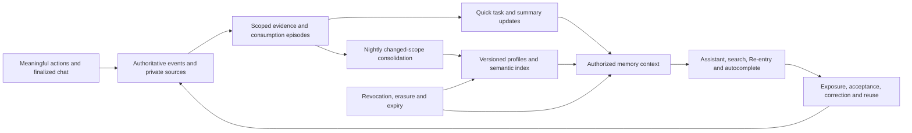

# Forma: scope-aware memory expansion plan

**Status:** Proposed architecture and delivery plan, 2026-09-02. Not implemented or deployed. Proposed defaults below are starting points for evaluation, not measurements or authorization to collect more data, retain it longer, or incur background provider costs.

## 1. Product outcome

Give Forma a coherent, automatically evolving understanding of a person's work across meaningful interactions—not only assistant messages. The same memory service should help conversations, document and block editing, Library discovery, Canvas, Re-entry, and optional autocomplete.

Memory should answer three different questions without confusing them:

1. **What is true or required here?** Current authored state, accepted decisions, and applicable policies.
2. **What is this person trying to do now?** Current request, selection, recent actions, unfinished work, and conversation.
3. **What earlier experience might help?** Relevant precedents, tentative preferences, consumption patterns, and past decisions at appropriate scopes.

The central design is **one memory contract over separately governed, evidence-backed projections**. There is no unrestricted global transcript or monolithic profile blob. Automatically updating an inferred profile is allowed after enrollment; silently turning its guesses into authored instructions is not.

“World scale” initially means the user's broader eligible personal history and explicitly transferable knowledge. It does not mean other users' private histories or automatic movement of confidential work between organizations. Public/domain knowledge can be a separate, clearly attributed retrieval source later; it is not evidence of personal preference.

### Outcomes to deliver

- A personal profile with context-specific facets at organization, project/subproject, document, block, and relevant additional scopes.
- Nightly consolidation of changed, eligible interaction history into patterns, summaries, and reviewable suggestions.
- Rolling conversation summaries shared by the floating Creator assistant and Chat Studio.
- Rolling document/block consumption episodes, including non-chat actions.
- Hybrid semantic recall over an explicitly governed mid-term history window.
- Shared suggestion/autocomplete APIs for multiple UIs, with local context dominant over broad background memory.
- Separate, minimized product analytics that measure usefulness without exposing personal semantic memory.

## 2. Starting point and architectural commitments

| Existing foundation | Expansion needed |
|---|---|
| Event ledger and separately erasable authored content | Reuse as source authority; add typed memory projections and dependency tracking. |
| Actor-private conversations, current document projections, bounded assistant context | Unify both conversational paths behind one server-owned memory assembler. |
| Authored preferences, tentative taste beliefs, Re-entry and intent trajectories | Preserve these distinctions while adding contextual facets and automatic consolidation. |
| Optional coarse attention episodes | Reuse opt-in rules; broaden meaningful action coverage without raw input surveillance. |
| Deterministic 24-dimensional hash embeddings | Keep for deterministic tests only; add an evaluated semantic embedding adapter and production index. |
| Flat projects, nested collections, exact project grants | Add real nested-project identity and ancestry; collection or URL nesting must not imply project nesting or access. |
| Retention sweeps and a Worker scheduled handler | Add durable changed-scope jobs; independently prove the deployed scheduler and consumers work without visitors. |

Current anchors: [event schema](/Users/westbrook/Documents/repos/codex/db/schema.ts:5), [project schema](/Users/westbrook/Documents/repos/codex/db/schema.ts:735), [assistant context](/Users/westbrook/Documents/repos/codex/worker/assistant-api.ts:504), [Chat Studio history](/Users/westbrook/Documents/repos/codex/worker/events-api.ts:808), [taste](/Users/westbrook/Documents/repos/codex/src/model/taste.ts:51), [indexing](/Users/westbrook/Documents/repos/codex/src/model/indexing.ts:5), [scheduled entry point](/Users/westbrook/Documents/repos/codex/worker/index.ts:272).

Preserve the recorded production direction: Postgres with pgvector/HNSW, with D1/R2 supporting the current Sites application. The new memory layer is not a reason to silently replace that decision or migrate every application table. See [D-0009 and D-0022](/Users/westbrook/Documents/repos/codex/docs/decisions.ndjson:9).

First fix the known structured-fact parsing defect in saved-output taste inference and make snapshot freshness explicit. Otherwise the new system inherits misleading evidence from [the current extraction path](/Users/westbrook/Documents/repos/codex/src/model/taste.ts:64).

## 3. Model zoom as resource scope plus interaction lenses

### 3.1 Canonical scopes

| Scope | What belongs here | Boundary |
|---|---|---|
| Personal/account-wide | Explicit personal defaults and supported, portable cross-project patterns | Private to the person; organization-sourced knowledge is not automatically portable. |
| Organization | Approved terminology, brand conventions, governed policies, published reusable knowledge | Shared knowledge is separate from an individual's private profile within that organization. |
| Team/program/portfolio, if needed | Explicitly grouped work and approved shared conventions | Optional grouping; no inferred membership, authority, or employee-performance profiling. |
| Project | Project goals, vocabulary, accepted precedents, constraints and recurring choices | Existing project permissions remain authoritative. |
| Nested project | Local specialization within a parent project | Explicit parent relation; bounded, validated ancestry; inheritance of context and access are separate policies. |
| Collection/Library | Reuse patterns and authored groupings | A facet within authorized resources, not a substitute for project ownership. |
| Canvas/Combined Context | Composition, relation roles, and the selected combination of sources | Preserve membership, isolation, ordering and source permissions. |
| Document/artifact | Current intent, accepted decisions, unresolved questions, revision and consumption history | Distinguish the authoring document from its generated outputs and their versions. |
| Page/slide/frame/section | A real subdivision of a document or artifact | Use durable subresource identity, not screen position. |
| Context block/field | Local wording, corrections, relationships and application-specific choices | Bind to block identity, source version and usage context. A reusable block can have multiple uses. |

The resource model is a scoped graph: canonical containment is acyclic; references, reuse and Combined Context membership are separate typed edges. A project has one canonical parent initially; cross-links do not create additional ownership or access paths. Reparenting must invalidate ancestry-dependent memory and caches without rewriting historical ownership receipts.

### 3.2 Cross-cutting lenses

The current page/view, session, task/intent trajectory, selected items, focus region, output type, audience, and authoring-versus-review mode refine relevance. They are **not** additional tenancy boundaries.

For example, the same document in Chat, an editor, or a presentation view should share content memory while showing different workflow suggestions. A page-specific memory key should combine the canonical surface and authorized resource identity, not a raw URL or translated route title. Brand/client/character entities can become explicit topic facets where useful; do not infer sensitive personal attributes.

### 3.3 Personal versus shared knowledge

Maintain separate subjects and visibility for:

- A person's private observations within an organization or project.
- Project-shared factual knowledge and accepted decisions.
- Organization-published conventions or enforceable policies.
- Approved aggregate workflow observations.

Readers of a derived item default to the **intersection of its sources' permitted readers**. A private chat about a shared document remains private. Broadening publication requires an explicit, versioned promotion with separate review of source confidentiality and attribution. Mere generalization does not declassify content.

## 4. Memory records and evidence

Use typed records rather than one continually rewritten biography:

| Kind | Examples | Authority |
|---|---|---|
| Authored preference/policy | “Use sentence-case headings for this project” | Explicit, scoped, revocable; some governed policies are non-overridable. |
| Current task state | “Preparing a five-slide client review; chart unresolved” | Derived from current authoritative state and explicit intent. |
| Episodic memory | A comparison, revision sequence, conversation segment or reuse episode | Historical evidence, not a current instruction. |
| Semantic project knowledge | Approved terminology, entity relationships, accepted decisions | Authority depends on the underlying authored/published sources. |
| Inferred profile facet | Repeated preference for shorter review drafts in this project | Tentative, confidence-bearing, local until broader evidence permits generalization. |
| Workflow/consumption pattern | Usually reviews slides before editing the source document | UI assistance only; not aesthetic taste or proof of comprehension. |
| Rejected/deferred path | “Do not suggest this palette again here” or “Not now” | Preserve the supplied reason and suppression scope; do not equate deferral with dislike. |

Each version carries: stable ID; subject and custodian; scope and lens applicability; kind; authority; erasable content reference; source event/turn/resource IDs and exact revisions; supporting and contradicting evidence; effective and recorded time; last independent evidence time; confidence; expiry; state; derivation/model/embedding version; consent/policy version; and source/permission/erasure epochs.

Separate confidence from permission, authority and similarity. A highly similar, frequently repeated guess never gains permission or becomes an explicit instruction.

### Proposed storage additions

- `memory_scopes`, typed edges and ancestry projection; references to existing project/resource identities rather than a second ownership registry.
- `memory_policy_versions` and scoped background-processing grants.
- `memory_items`, immutable version metadata, and erasable private bodies.
- `memory_sources` and dependency edges, including supporting excerpts only when their separate retention is authorized.
- `memory_episodes` and rolling per-resource/window consumption projections.
- `memory_scope_heads`: separate human-activity, source-change, successfully processed, and erasure/permission epochs.
- `memory_jobs` plus transactional index/outbox work, leases, attempts and cost receipts.
- `memory_index_manifest`, invalidations and cleanup receipts.
- Suggestion exposure/outcome records linked to the originating memory version and UI placement.

These are proposed logical records; combine tables where existing schema contracts fit. Natural-language memory and excerpts stay outside immutable public event metadata. Vectors are disposable indexes, not source truth.

## 5. Learn from all meaningful interactions

Reuse existing events wherever possible. Add missing semantic outcomes instead of duplicating the ledger or logging every browser input.

| Interaction | Evidence to retain | Do not infer |
|---|---|---|
| Completed edits, locks, restore, undo/redo | Exact changed fields, accepted version and correction lineage | Every experimental edit is a permanent preference. |
| Document/block open, expand, select | Encounter and inspection of an exact resource/version | Viewing proves liking, reading or understanding. |
| Compare, save, pin, export, approve, promote draft | Consideration and commitment, joined to the actual output/context | Every visible property of a saved result caused its selection. |
| Copy/reuse a block, context set or output | Source, destination and lineage; independent later use | Copies and descendants are independent evidence samples. |
| Reject, discard, undo, dismiss | Exact target, scope and supplied reason | “Not now” means “never,” or one rejection is a global dislike. |
| Navigation, resume, interrupted/completed work | Task continuity and working-mode transitions | Background polling or render completion is new human intent. |
| Search and discovery | Explicit submitted query where permitted, chosen resource and useful outcome | Every unfinished search string should be persisted. |
| Artifact review/consumption | Inspected slide/frame/section, comparison, export or subsequent reuse | Opening one frame means the whole output was consumed. |
| Optional visible-page attention | Existing coarse active/idle timing and semantic context | Raw keystrokes, mouse paths, coordinates or ambient behavior. |
| Assistant/autocomplete suggestions | Exposure, acceptance, partial edit, rejection, undo and later reuse | Acceptance independently proves the system's original inference. |

Evidence envelopes include server-validated actor/scope, canonical surface, resource version, action family, origin (`user`, `assistant`, `autocomplete`, `import`, `copy`), exposure ID, correlation/causation and compensation references, plus capture/consent versions. Client-supplied IDs never grant access.

### Rolling document/block consumption

Build event-derived episodes with document-level records and block/artifact subrecords:

`encountered → inspected → compared → changed → committed/reused`

The stages are descriptive, not mandatory or proof of comprehension. Close episodes on scope/task change, explicit completion or an inactivity boundary; persist passive timing only under attention consent. Coalesce repeated events and duplicate receipts into one underlying outcome.

Maintain rolling 1/7/30/90-day views where policy permits: independent visits, revisits, revisions inspected, active inspection time when enabled, reuse destinations, comparison/approval outcomes, interruptions and unresolved follow-ups. Without passive capture, explicit actions still produce useful sequences. Use artifact revision IDs and document/block source versions so consumption of an old result is not mistaken for review of its replacement.

## 6. Two update cycles

### 6.1 Quick cycle

- Fold current document/block state and explicit preference changes immediately.
- Update unfinished-task and consumption projections incrementally.
- Queue conversation-summary updates after a stable segment leaves the recent window; do not wait until night to preserve continuity.
- Invalidate stale/retracted information immediately.
- Serve suggestions asynchronously; typing, navigation and ordinary authoring must not wait for memory work.

### 6.2 Nightly cycle when human activity exists

Proposed default: one consolidation per enabled actor/scope during a quiet local-time window, with jitter, a validated IANA timezone and a documented fallback. Organization-shared consolidation uses its configured timezone and only eligible shared contributions.

1. **Detect work:** select scopes with new qualifying human activity or pending work from the same already-admitted review. Exclude polls, synthetic replay, retries, summaries and other self-generated activity. Track dirty descendants; update ancestor facets only where sources are allowed there.
2. **Freeze inputs:** capture each source stream's high-water mark, consent, permissions, source/erasure epochs and recipe version. Cross-stream sequence numbers are not globally comparable; use a cursor set or durable ingestion watermark.
3. **Claim:** create an idempotent leased job keyed by scope, source interval/digest and versions. A calendar date alone is insufficient. New events arriving after the cutoff remain pending.
4. **Normalize and embed:** produce bounded semantic descriptions of decisions, interaction episodes, conversation segments and outcomes. Do not embed every raw JSON telemetry event. Record embedding model/version, source hash and visibility partition.
5. **Review patterns:** combine changed evidence with eligible mid-term neighbors; compute deterministic frequencies, transitions, independent support, contradictions and decay. Use an optional budgeted model pass for grounded interpretation, not for inventing facts.
6. **Evolve profile:** add, revise, weaken, supersede or retire inferred facets. Keep local patterns local; record why any broader generalization is supported. Produce only a bounded number of useful suggestions.
7. **Validate and publish:** recheck source rights, policy and epochs. Atomically record memory versions, dependencies, index-outbox intent and processed watermark. Expose index-dependent versions only after their manifest is ready; a stale external vector cannot override authoritative eligibility.
8. **Recover:** resume failed stages without duplicate claims, billing or suggestions. Reconcile uncertain provider receipts before retrying. If budgets are exhausted, retain usable prior memory and expose a freshness/backlog status.

A related late provider completion can update its existing task episode; it must not continually manufacture new human activity or an unbounded chain of nightly reviews.

**Maintenance is independent:** expiry, erasure, access revocation, index cleanup, abandoned leases and provider accounting reconciliation must run even if no user visits or new human events occur. No-activity gating applies to new pattern-learning work, not privacy correctness.

### Background authorization

Introduce an explicit, revocable grant for narrowly defined background purposes: embedding, summarization, pattern review and optional autocomplete. Record allowed providers/models, scopes, monthly/daily budget caps, retention choice and expiry. Reuse personal/organization/platform reservation and settlement rules. This grant must not authorize paid output generation, document edits, sharing, enrollment changes or escalation of access. Do not emulate direct user clicks to satisfy existing paid-operation controls.

## 7. Rolling conversation summaries

Unify the floating Creator assistant and Chat Studio around a canonical actor/private-conversation scope, retaining their different UI and operation permissions. Keep the internal-platform helper in its own audience boundary; do not give it Creator histories simply because the memory service is shared.

Store structured summary segments containing:

- Current goals and referenced entities.
- Accepted decisions versus unaccepted assistant proposals.
- Rejected alternatives, including reason/scope when supplied.
- Unresolved questions, blockers and next steps.
- Exact supporting turns/events, covered prefix and source revision.

Keep recent finalized messages alongside the summary. The context assembler should include **summary through sequence N + uncovered recent turns**, with explicit coverage, not gaps or double-counted segments. Newest unsummarized turns remain usable while a job runs.

Proposed starting budgets: roughly 500 summary tokens and up to four short recalled excerpts, subject to the complete request's actual token/byte limit. Preserve the floating assistant's current 16 KiB ceiling initially. Current instructions and required constraints take priority over optional memory; failure to fit mandatory context blocks risky dispatch rather than silently dropping it.

Use stable segment summaries with exact dependencies, then a bounded rolling digest. Periodically rebase from available authorized evidence instead of endlessly summarizing previous summaries. Never reconstruct missing text from hashes, embeddings or model guesses. Historical statements are labeled historical and checked against current authored state before use.

## 8. Semantic recall with local dominance

### 8.1 Request contract

One server-owned assembler receives the authenticated actor, authorized workspace, canonical scope and ancestry, current task/request, surface/field purpose, selected resources, temporal window and context budget. It returns separate sections for:

1. Applicable policies and current authoritative state.
2. Active explicit preferences, resolved by applicability and authority.
3. Recent conversation and task context.
4. Rolling summaries.
5. Retrieved historical evidence and tentative profile facets.
6. Sources, conflicts, freshness, omitted coverage and budget receipts.

Source aliases sent to providers should not reveal private IDs or unapproved project names. Summary and retrieved text are untrusted evidence, never system instructions or tool permissions. Mutations continue to be validated against current exact resource versions.

### 8.2 Retrieval sequence

1. Resolve current grants and permissible use: tenancy, actor-private visibility, nested ancestry, source rights, consent, retention, resource versions and publication boundaries.
2. Query only eligible partitions/scopes. Do not retrieve a global top-K and remove unauthorized rows afterwards.
3. Combine exact/lexical/entity lookup with semantic similarity and typed relation/intent matches. Exact dates, names and identifiers should not rely only on embeddings.
4. Deduplicate shared lineage, episode repeats, and overlaps between summaries and source excerpts.
5. Apply source-specific time windows, explicit supersession and conflict rules.
6. Rank eligible supporting evidence using task fit, semantic match, scope distance, freshness, independent support and usefulness; diversify and cap broad sources.
7. Hydrate only necessary authorized evidence, then recheck source/permission/erasure epochs before provider submission, rendering and any later action commit.

Cache keys must include actor, tenant/visibility partition, grants/permission epoch, scope ancestry/version, surface/field, query/task, selected resource versions, memory version and erasure epoch. Cache hits are still subject to current eligibility.

### 8.3 Proposed locality priors

These are tuning seeds for **soft relevance**, not probabilities or authority multipliers:

| Relationship to the active work | Initial prior |
|---|---:|
| Exact field/block/selection | 1.00 |
| Same document/artifact or active Combined Context | 0.90 |
| Same nested project | 0.75 |
| Same project, authorized related documents | 0.60 |
| Explicitly inheritable ancestor project | 0.40 |
| Eligible organization-shared knowledge | 0.25 |
| Eligible personal cross-project background | 0.15 |
| Separately approved external/domain background | 0.10 |

For a document-centric request, start with a soft-memory budget of approximately **70% local, 20% project/ancestors, at most 10% broader background**. These are ceilings, not quotas to fill with weak matches. Reallocate for a project/org overview or an explicit historical-search request. Current truth and mandatory policies have a separate budget and never receive these downweights.

Authority resolution is lexicographic, not a blended score: enforce applicable non-overridable policy and protected decisions; honor explicit supersession/effective dates; prefer narrower scope among compatible, overridable defaults of equivalent authority; then consider recency. An inferred local habit cannot override an explicit broader rule. Surface genuine unresolved contradictions instead of averaging them.

### Example

A creator often makes short, visually sparse decks. A specific project favors data-rich reviews; a subproject targets a technical committee; the current slide requires a detailed comparison table. Suggest the comparison structure required here, using earlier local review decisions. Let the creator-wide pattern lightly influence wording concision, not remove necessary detail. Organization-approved accessibility requirements remain mandatory regardless of their broader scope.

## 9. Automatic profile evolution and UI uses

Automatically maintain separate facets for creative defaults, terminology/entities, current and recurring goals, output/audience conventions, reuse patterns, and workflow habits. Preserve exceptions by scope instead of flattening conflicting preferences into one global label.

Generalize upward only with independent support across eligible tasks/sessions and permission to use those sources at the broader level. Maintain counterevidence. Proposed initial promotion criteria should be evaluated by facet; one save, long dwell, or one accepted completion is insufficient. Broader confidence must not increase merely because a nightly job rephrased an old claim.

| UI | Memory-assisted behavior |
|---|---|
| Assistant and Chat Studio | Recall relevant decisions, explain continuity, distinguish remembered evidence from current instructions. |
| Document/block editor | Dismissible field-specific ghost text, terminology, structure and related-context suggestions. |
| Canvas/Combined Context | Suggest relevant blocks or relationships without adding/moving them automatically. |
| Library/search | Scoped semantic recall of precedents and reusable context, with source and time filters. |
| Project/Re-entry | Unfinished intentions, meaningful changes and useful restart points. |
| Output review | Previously inspected revisions, unresolved comparisons and relevant prior feedback. |
| Taste & time | Profile facets with scope, evidence, counterevidence, confidence, freshness and correction controls. |

Autocomplete should debounce and cancel stale requests, bind responses to the exact field/resource revision, respect language and IME composition, and remain keyboard-accessible. Do not persist unsent draft text as telemetry; sending a current draft fragment for a requested completion is a distinct, disclosed processing permission. Prefer cached/local suggestions when external processing is disabled.

Accepting a completion is an explicit reversible edit, with `autocomplete` origin retained. Track whether it survives later edits and is independently reused. Neither suggestions nor ghost text may submit forms, trigger paid generation, publish knowledge, replace locked wording or silently narrow available choices.

## 10. Analytics without turning analytics into a personal dossier

Use the same validated events to produce separate purpose-limited views:

- **Personal memory:** scoped semantic evidence and reviewable inferences.
- **Project/org work knowledge:** approved shared decisions and source-grounded knowledge.
- **Product analytics:** minimized aggregates about completion, friction, discovery, latency, errors, suggestion exposure, correction and usefulness. No raw prose, private summaries or inferred personal claim text.
- **Operational diagnostics:** job freshness, index lag, failures, cost, cleanup status and permission checks, with redacted identifiers as needed.

Record suggestion exposure separately from subsequent actions so induced choices do not become independent preference evidence. Cap correlated evidence from copies, repeated impressions and model descendants. Evaluate diversity and retained usefulness, not click-through alone. Organization-level aggregate patterns require a minimum cohort and small-cell suppression; these reduce disclosure risk but are not a guarantee of anonymity. Do not add employee scoring or sensitive-trait inference.

Extend the existing minimized [analytics projection](/Users/westbrook/Documents/repos/codex/worker/analytics-api.ts:18), not its access to private creative prose. Treat broken workflows, slow providers and budget failures as system friction before attributing behavior to the person.

## 11. Retention, forgetting and control

### Proposed initial retention policy

| Data | Starting proposal |
|---|---|
| Existing raw creative chats/temporary processing | Keep current 30-day default unless explicitly changed. |
| Optional raw attention detail | Preserve 14-day use window and existing opt-in boundaries. |
| Mid-term episodic recall and rolling summaries | 90 days only under a separately disclosed derived-memory/support-evidence policy; otherwise limited by source eligibility. |
| Inferred profile facets | Reassess nightly when active; decay by last independent evidence, not last rewrite; retire unsupported/stale facets. |
| Explicit saved preferences and authored work | Remain until revoked/removed under applicable policies. |
| Operational receipts | Existing governed policy; do not make them ordinary assistant recall solely because they are retained. |

Longer-lived derived memory is not a loophole around transcript expiry. If a summary needs to outlive its raw source, enroll that minimal summary and necessary support excerpts into an explicit retention class with the same confidentiality and erasure obligations. Without it, expire the derivative when its necessary evidence becomes unavailable. Ninety days is a proposed starting window; 180 days should require evidence of benefit and a deliberate policy choice.

Do not renew retention on reads, retrieval, nightly rewrites or self-citation. Shortening policy immediately changes eligibility, then queues physical cleanup. Increasing it must not revive erased content or retroactively extend old records without a governed migration.

User controls: memory on/off by scope; review why an item is remembered; correct/forget/suppress; save as an explicit preference; choose scope; publish to a project/org through approval; temporary/no-personalization conversations; export eligible memory; and view cleanup status. Clarify that “no personalization” does not erase necessary document edits or imply that all provider/accounting retention is disabled.

On erasure, source correction or access loss: tombstone affected memory and bump epochs first, invalidate descendants and caches, then delete/rebuild external vectors and retained bodies asynchronously. In-flight jobs must fail publication guards. “Forget this pattern” must include a scoped suppression/exclusion so replay of retained operational events cannot immediately recreate it. Legal-held material is restricted retention, not normal assistant eligibility.

Do not claim all-device, backup, provider or application-level encryption guarantees that have not been implemented and verified. Existing personal erasure has explicit exceptions in [the privacy API](/Users/westbrook/Documents/repos/codex/worker/privacy-api.ts:87); the memory rollout must disclose and extend its scope honestly.

## 12. Infrastructure and cost plan

1. Keep events, policy, provenance, jobs and authoritative memory manifests in current D1 initially; large private objects stay in R2 where appropriate. Introduce interfaces for the planned production database transition.
2. Put real semantic embeddings behind a versioned adapter. Select model/dimensions using representative multilingual Forma retrieval tests, not the existing hash-vector fixtures. Model change means a versioned re-embedding projection, not rewriting events.
3. Preserve the Postgres/pgvector production index direction. A Sites-compatible authenticated HTTP service is one candidate bridge; do not assume raw TCP or new vector/queue bindings are available from the current hosting configuration. Provisioning, residency, grants and deletion behavior are explicit gates.
4. Use tenant/private-visibility partitioning plus query-level authorization and live source checks. For pgvector, filtered approximate search needs recall testing because index filtering can reduce returned matches; small authorized candidate sets may use exact search, and larger sets may need partitions and bounded iterative scans. See [pgvector filtering, multitenancy and hybrid search](https://github.com/pgvector/pgvector#filtering).
5. Add Postgres row security as defense in depth where that adapter is used; do not run the serving path as a role that bypasses it. Table owners and privileged roles need explicit handling. See [PostgreSQL row-security policies](https://www.postgresql.org/docs/17/ddl-rowsecurity.html).
6. Use a lightweight scheduled dispatcher plus durable, bounded consumers. Cloudflare's schedules are UTC, so local-night selection belongs in the application. The existing scheduled handler alone does not prove deployment wiring. See [Cloudflare Cron Triggers](https://developers.cloudflare.com/workers/configuration/cron-triggers/).
7. Treat delivery as repeatable; leases, idempotency and publication guards are required regardless of runner. If Cloudflare Queues is selected through supported provisioning, its at-least-once contract specifically requires deduplication. See [delivery guarantees](https://developers.cloudflare.com/queues/reference/delivery-guarantees/).
8. Reserve and settle per-stage costs; limit changed evidence, provider tokens, vector queries, scope fan-out and suggestions. A user with no new eligible activity should incur no new pattern-learning inference charge. Bound maintenance separately.

Do not make D1/R2, a vector index, or browser cache independently authoritative for the same state. Use a manifest/outbox and explicit freshness to handle partial publication. During index failure, fall back to current state, retained recent conversation and eligible lexical/project lookups; disclose missing semantic coverage instead of fabricating recall.

## 13. Phased delivery

| Phase | Deliverables and dependencies | Acceptance gate |
|---|---|---|
| **0 — Baseline and repair** | Fix saved-output taste parsing; inventory events/capture gaps; record current retention/consent and assistant behavior; establish labeled retrieval/summary fixtures. | Current behavior remains covered; structured facts produce meaningful evidence; synthetic data cannot enter real personal memory. |
| **1 — Scope, authority and lifecycle contracts** | Add canonical scope/ancestry, nested-project events and cycle checks, actor-private overlays, policy/grants, memory/source records and invalidation graph. Define UI-page versus artifact-page identity. | Nesting grants no unintended access; local exceptions and governed rules resolve deterministically; erasure prevents resurrection before any new retrieval ships. |
| **2 — All-interaction evidence** | Normalize meaningful action outcomes and origin lineage; rolling document/block/artifact episodes; source-version joins; dirty human-activity watermarks; minimal analytics. Depends on Phase 1. | Non-chat work is accurately represented; view-only activity creates no preference; duplicates/copies/assistant descendants do not multiply evidence. |
| **3 — Shared context and rolling summaries** | Introduce the common server assembler, initially preserving existing recall behavior; add idempotent private conversation-segment summaries and coverage/cost receipts. Depends on Phases 1–2. | Both Creator conversation paths use the same eligible memory rules; no summary gaps, stale overwrite, private-chat leakage or constraint loss. |
| **4 — Semantic recall and nightly profile evolution** | Provision evaluated embedding/index and no-traffic job runner; hybrid scoped search, contradiction handling, automatic inferred facets, nightly review and source-grounded suggestions. Depends on Phases 1–3. | Better scoped recall than recent-turn/hash baselines; inactive accounts skip learning; duplicate/missed-night/DST/revocation tests pass; publication is resumable and budgeted. |
| **5 — Multi-UI assistance and controls** | Memory inspector, scope selector, source explanations, correction/forget/pin/publish; autocomplete and suggestions in editor, Canvas, Library, Re-entry and output review; nested-project navigation/admin controls. Depends on Phases 2–4. | Accept/reject/undo works across supported input modes; no unsolicited writes or paid actions; local context wins; quality includes retained usefulness and correction, not clicks alone. |
| **6 — Graduated broad recall and operations** | Opted-in shadow comparison, then same-document/project retrieval, then nested/ancestor and approved organization/personal background; performance, deletion, cost and fairness hardening. | Isolation and erasure suites pass; real no-visitor night run is witnessed; restore/reindex and rollback drills succeed; owners approve retention and cross-scope rollout. |

Parallelizable work after Phase 1: action/consumption instrumentation, conversation-summary implementation, index/runner provisioning, and memory-control design. Agree on evidence IDs, authority and invalidation contracts before splitting that work. Keep source-writing ownership coordinated for this Sites project.

### Existing integration points

- Identity, scope and migrations: [database schema](/Users/westbrook/Documents/repos/codex/db/schema.ts), [project access](/Users/westbrook/Documents/repos/codex/worker/project-access.ts), [access policy](/Users/westbrook/Documents/repos/codex/worker/access-policy.ts), [event models](/Users/westbrook/Documents/repos/codex/src/model/events.ts).
- Capture and derived episodes: [store](/Users/westbrook/Documents/repos/codex/src/state/store.ts), [event API](/Users/westbrook/Documents/repos/codex/worker/events-api.ts), [attention observer](/Users/westbrook/Documents/repos/codex/src/components/forma-attention-observer.ts), [intent trajectories](/Users/westbrook/Documents/repos/codex/src/model/intent-trajectories.ts), [document-view signals](/Users/westbrook/Documents/repos/codex/src/model/document-view-signals.ts).
- Assembly and provider boundaries: [conversation context](/Users/westbrook/Documents/repos/codex/src/model/conversation-context.ts), [assistant API](/Users/westbrook/Documents/repos/codex/worker/assistant-api.ts), [assistant provider](/Users/westbrook/Documents/repos/codex/worker/assistant-provider.ts), [Chat Studio provider adapter](/Users/westbrook/Documents/repos/codex/worker/openai-adapter.ts), [prompt policy](/Users/westbrook/Documents/repos/codex/src/model/prompt-policy.ts).
- Retrieval/profile surfaces: [indexing](/Users/westbrook/Documents/repos/codex/src/model/indexing.ts), [taste](/Users/westbrook/Documents/repos/codex/src/model/taste.ts), [memory UI](/Users/westbrook/Documents/repos/codex/src/components/forma-memory.ts), [briefs](/Users/westbrook/Documents/repos/codex/src/model/brief.ts), [workspace intelligence](/Users/westbrook/Documents/repos/codex/src/model/workspace-intelligence.ts).
- Lifecycle and operations: [private-content policy](/Users/westbrook/Documents/repos/codex/worker/pilot-policy.ts), [privacy](/Users/westbrook/Documents/repos/codex/worker/privacy-api.ts), [runtime](/Users/westbrook/Documents/repos/codex/worker/runtime.ts), [Worker entry](/Users/westbrook/Documents/repos/codex/worker/index.ts), [analytics](/Users/westbrook/Documents/repos/codex/worker/analytics-api.ts).

Proposed new modules belong beside these owners: pure scope/evidence/ranking contracts under `/Users/westbrook/Documents/repos/codex/src/model/`; server authorization, jobs, retrieval and invalidation under `/Users/westbrook/Documents/repos/codex/worker/`. Avoid a new client-owned profile store or a second application-wide event bus.

## 14. Evaluation and release gates

Build fixtures with conflicting preferences across projects, repeated entities across tenants, nested project moves, shared blocks in different usages, multilingual conversations, old/expired evidence, parallel intentions, imported documents with hostile instructions, assisted-content lineage and no-activity nights.

| Dimension | Required checks |
|---|---|
| Scope isolation | No forbidden content, source names, counts or ranking influence from other tenants/private actors; revoke during retrieval/commit; stale vector/cache and identical-ID cases. |
| Locality/authority | Current task and governed constraints survive; narrow explicit overrides apply only where allowed; broad background cannot overrule local intent. |
| Summary quality | Accepted versus proposed is preserved; exact provenance and coverage; contradictions visible; no accumulated summary drift or fabricated missing evidence. |
| Retrieval quality | Gold-set recall/ranking by zoom, language, age and task; exact/entity plus paraphrase queries; compare recent-turn, lexical, hash-vector and semantic variants. |
| Consumption fidelity | Correct document/block/artifact revision; views do not equal preference; passive opt-out still allows legitimate direct-action episodes. |
| Profile calibration | Supported and contradicted facets, correction rate, independent evidence count; no broad generalization from one output or model-induced feedback loop. |
| Suggestion usefulness | Explicit acceptance, surviving edits, later independent reuse, dismissal/undo and task completion; non-personalized holdout; no optimization solely for engagement. |
| Lifecycle | Source deletion immediately removes descendants from retrieval; later workers/reindex cannot resurrect; policy shortening, legal hold and cleanup receipts are tested. |
| Jobs and cost | No duplicate publication/charges; bounded retries; new events beyond cutoff retained; partial failure/restart, missed night, DST and tenant fairness; zero new learning work for unchanged accounts. |
| UX and performance | Retrieval/autocomplete is nonblocking and cancellable; current revision binding; accessibility/IME/localization; measured p95 latency, token spend and meaningful fallback. |

Set numerical latency, precision, cost and throughput targets after the baseline/provisioning spike, then freeze them for pilot evaluation. Hard safety gates—no unauthorized disclosure, no resurrected erased memory, no inferred hard-constraint promotion—are not traded for a higher suggestion acceptance rate.

Extend existing tests where behavior fits: conversation-context, assistant-runtime/provider, indexing, taste, attention, brief, document-view signals, intent trajectories and retention/privacy suites. Add focused integration suites only for genuinely new scope, job and invalidation boundaries. Production semantic quality cannot be established by deterministic hash fixtures alone.

Roll back by disabling scoped memory reads/learning grants and returning to current-state/recent-turn assembly. Do not undo authored work or delete the event log. Rebuild memory projections from remaining authorized sources after a defect is repaired.

## 15. Decisions to resolve before implementation or rollout

The plan can proceed through design and synthetic validation without interrupting the user for these now. Record accountable choices before their corresponding rollout gate:

1. **Meaning of broad recall:** adopt eligible personal background by default; choose whether approved organization/public knowledge also participates, and in which applications.
2. **Nested-project semantics:** one canonical parent, cross-links separate, explicit context inheritance; decide whether any access inheritance is desired rather than assuming it.
3. **Mid-term retention:** proposed 90-day derived memory with disclosed minimal support evidence versus source-bound retention; define temporary/no-memory behavior and export/erasure scope.
4. **Learning and autocomplete enrollment:** scope defaults, processing permission, permitted UI fields, inference sensitivity exclusions, and separately revocable background grants.
5. **Production services:** evaluated embedding model, HTTP-accessible vector service, supported scheduler/consumer, residency and proof of lifecycle deletion; preserve or explicitly supersede the recorded production database decision.
6. **Budgets and evidence thresholds:** per-user/org processing caps, suggestion frequency, confidence calibration, aggregation cohort minimum and rollout success targets.

**Recommended first implementation slice:** Phase 0 plus the Phase 1 contracts and invalidation tests, followed by a single end-to-end private document flow: actions and conversation → episode/summary → scoped recall → inspectable suggestion → correction/forget. Expand to nested-project and broad context only through the same proven contract.
